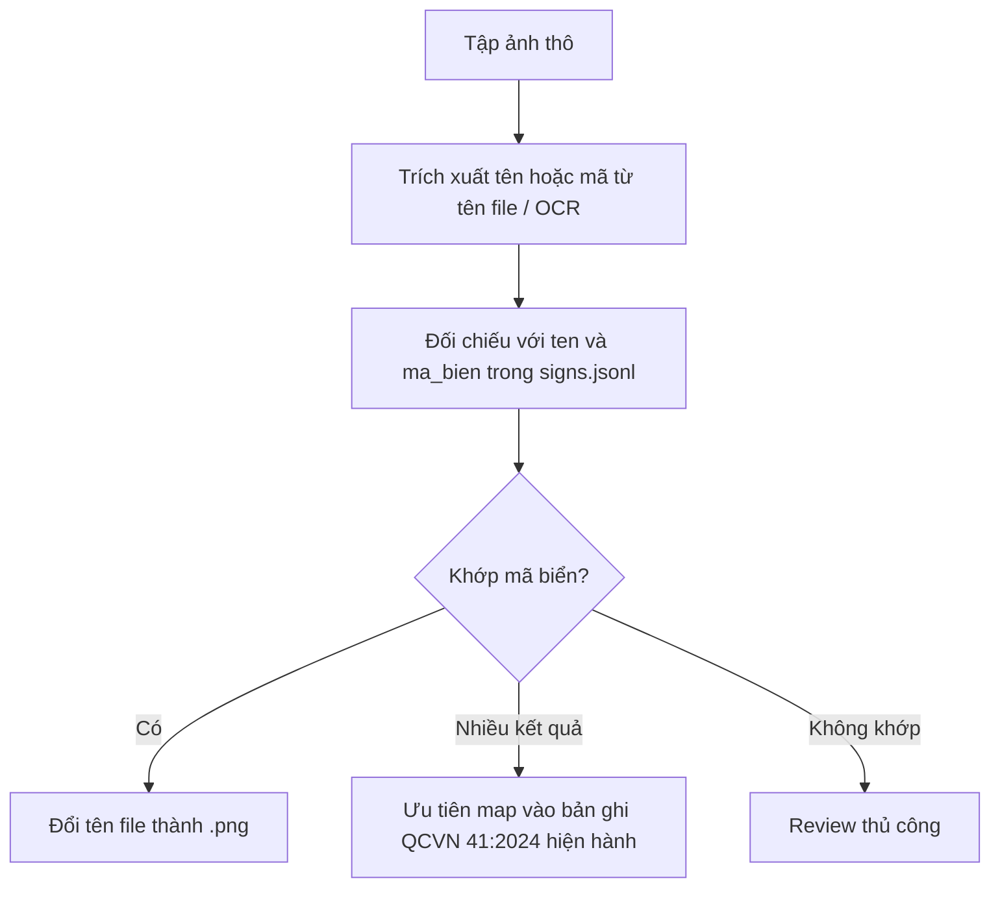

# Dữ liệu Biển báo Giao thông (`signs.jsonl`)

Tài liệu này giải thích chi tiết về cấu trúc, nguồn gốc, danh mục file PDF công báo, phương pháp so sánh hình ảnh và hướng dẫn tích hợp hình ảnh cho tập dữ liệu biển báo giao thông tại [`data/processed/signs/signs.jsonl`](../data/processed/signs/signs.jsonl).

---

## 1. Nguồn gốc dữ liệu (Data Provenance)

Tập dữ liệu bao gồm **887 bản ghi biển báo**, được trích xuất từ **2 văn bản quy chuẩn kỹ thuật quốc gia (QCVN)** tương ứng với 2 giai đoạn hiệu lực của pháp luật giao thông đường bộ Việt Nam:

| Văn bản | Quy chuẩn | Số bản ghi | Trạng thái hiệu lực | Ghi chú |
|---|---|:---:|---|---|
| **51/2024/TT-BGTVT** | QCVN 41:2024/BGTVT | **446** | Từ 01/01/2025 | **Hiện hành**, đi kèm Luật Trật tự, ATGTĐB 2024 |
| **54/2019/TT-BGTVT** | QCVN 41:2019/BGTVT | **441** | 01/07/2020 – 01/01/2025 | **Hết hiệu lực**, phục vụ đối chiếu & truy cứu lịch sử |
| **Tổng cộng** | | **887** | | |

### Thống kê so sánh số lượng bản ghi giữa 2 Quy chuẩn

| Tiêu chí so sánh | Số lượng | Chi tiết mã biển & Ghi chú |
|---|:---:|---|
| **Mã biển chung (`ma_bien` có ở cả 2019 và 2024)** | **436 mã** | Các biển nền tảng (`P.101`, `P.102`, `W.201`, `DP.135`...). Phần lớn giữ nguyên hình vẽ đồ họa. |
| • *Mô tả (`mo_ta`) giống nhau tuyệt đối 100%* | 43 bản | Câu chữ quy định giữ nguyên hoàn toàn giữa 2 quy chuẩn. |
| • *Mô tả (`mo_ta`) có chỉnh lý / cập nhật* | 393 bản | Cập nhật số thứ tự hình vẽ phụ lục (ví dụ `Hình B.27c` → `B.27e`), hoặc đổi trích dẫn từ *Luật GTĐB 2008* sang *Luật Trật tự ATGTĐB 2024*. |
| **Mã biển chỉ có ở bản 2019 (bị bãi bỏ / thay đổi trong 2024)** | **5 mã** | `I.204`, `I.502`, `S.505`, `W.211a`, `W.211b` |
| **Mã biển mới bổ sung ở bản 2024 (chưa từng có trong 2019)** | **10 mã** | • `I.428a`, `I.428b`, `I.428c`: Biển trạm nạp điện / dịch vụ sạc xe điện.<br>• `R.403g`, `R.403h`, `R.403k` & `R.404g`, `R.404h`, `R.404k`: Biển bắt đầu/hết đường dành cho xe máy điện, xe đạp điện.<br>• `W.222`: Biển cảnh báo đường có gờ giảm tốc. |

> 📁 **File dữ liệu gộp:** Toàn bộ 451 mã biển duy nhất (kèm nhãn đánh dấu `merge_status` và `ghi_chu`) đã được kết xuất sẵn tại [`data/processed/signs/sign_merge.json`](../data/processed/signs/sign_merge.json).

### Hiện diện trong kho dữ liệu dự án
- **Văn bản Markdown đã chuẩn hóa:**
  - [`data/processed/documents/51_2024_TT_BGTVT.md`](../data/processed/documents/51_2024_TT_BGTVT.md) *(8.079 dòng)*
  - [`data/processed/documents/54_2019_TT_BGTVT.md`](../data/processed/documents/54_2019_TT_BGTVT.md) *(6.176 dòng)*
- **Metadata văn bản:** Đăng ký trong [`data/processed/meta/documents.jsonl`](../data/processed/meta/documents.jsonl) với phân loại `scope: "road_core"`.

---

## 2. Danh mục File PDF Công báo và Vị trí Hình ảnh

Các file PDF Công báo gốc được lưu tại thư mục [`data/raw/pdf/`](../data/raw/pdf/). Do quy chuẩn rất dày, Công báo Chính phủ chia nhỏ thành từng tập (khoảng 95 trang/tập):

### 2.1. Quy chuẩn 2024 (Thông tư 51/2024/TT-BGTVT)

| Tên file PDF | Dung lượng | Số trang | Nội dung chi tiết |
|---|:---:|:---:|---|
| `51_2024_TT_BGTVT_cb53148.pdf` | 3.1 MB | 95 | Lời văn Thông tư & Toàn văn các Điều quy chuẩn (Điều 1 – Điều 84) |
| **`51_2024_TT_BGTVT_cb53152.pdf`** | 7.8 MB | 95 | **⭐ CHỨA HÌNH ẢNH BIỂN BÁO MÀU:**<br>• Phụ lục B: Biển báo cấm (P.101 – DP.135)<br>• Phụ lục C: Biển báo nguy hiểm (W.201 – W.247)<br>• Phụ lục D: Biển hiệu lệnh (R.122 – R.434)<br>• Phụ lục E: Biển chỉ dẫn (I.401 – IE.474) |
| `51_2024_TT_BGTVT_cb53155.pdf` | 20.4 MB | 95 | Phụ lục F (Biển phụ) & Phụ lục G (Vạch kẻ đường, vạch kênh hóa) |
| **`51_2024_TT_BGTVT_cb53158.pdf`** | 30.8 MB | 95 | **⭐ BẢN VẼ KỸ THUẬT CHI TIẾT:** Bản vẽ kích thước hình học, khoảng cách, nét vẽ chuẩn của từng loại biển báo |
| `51_2024_TT_BGTVT_cb53161.pdf` | 6.4 MB | 45 | Phụ lục O, P... (Quy cách cọc tiêu, gương cầu lồi, dải phân cách) |

> 📌 **Tìm ảnh biển báo 2024:** Mở tập **`51_2024_TT_BGTVT_cb53152.pdf`** (hình minh họa màu) và **`51_2024_TT_BGTVT_cb53158.pdf`** (bản vẽ kỹ thuật chi tiết).

### 2.2. Quy chuẩn 2019 (Thông tư 54/2019/TT-BGTVT)

| Tên file PDF | Dung lượng | Số trang | Nội dung chi tiết |
|---|:---:|:---:|---|
| `54_2019_TT_BGTVT_cb29884.pdf` | 2.6 MB | 95 | Lời văn Thông tư & Toàn văn các Điều quy chuẩn (Điều 1 – Điều 90) |
| **`54_2019_TT_BGTVT_cb30010.pdf`** | 8.1 MB | 95 | **⭐ CHỨA HÌNH ẢNH BIỂN BÁO MÀU:**<br>Phụ lục B, C, D, E (Biển cấm, nguy hiểm, hiệu lệnh, chỉ dẫn theo QCVN 41:2019) |
| `54_2019_TT_BGTVT_cb30013.pdf` | 13.3 MB | 102 | Phụ lục G (Vạch kẻ đường) và bản vẽ kích thước kỹ thuật |

> 📌 **Tìm ảnh biển báo 2019:** Mở tập **`54_2019_TT_BGTVT_cb30010.pdf`** để đối chiếu hình vẽ gốc với tập `cb53152` của bản 2024.

---

## 3. Cấu trúc trường dữ liệu (Schema Definition)

Mỗi dòng trong `signs.jsonl` là một đối tượng JSON đại diện cho một node `TrafficSign` trong Knowledge Graph:

```json
{
  "sign_id": "QCVN 41:2024/BGTVT::DP.127",
  "doc_id": "51_2024_TT_BGTVT",
  "ma_bien": "DP.127",
  "nhom": "Biển hết cấm",
  "ten": "Biển hết tốc độ tối đa cho phép theo biển ghép",
  "bien_phu_variant": "",
  "mo_ta": "Hình B.27e - Biển số P.127c B.27d Biển số DP.127 ...",
  "qcvn": "QCVN 41:2024/BGTVT",
  "so_hieu": "51/2024/TT-BGTVT",
  "unit_id": "51_2024_TT_BGTVT::QCVN41_2024_BGTVT::D84",
  "ngay_hieu_luc": "2025-01-01",
  "ngay_het_hieu_luc": null
}
```

### Chi tiết các trường:

| Trường | Kiểu dữ liệu | Ý nghĩa | Ví dụ |
|---|---|---|---|
| `sign_id` | String | Khóa chính (Primary Key) định danh duy nhất biển báo trong KG. Kết hợp giữa tên Quy chuẩn và Mã biển. | `"QCVN 41:2024/BGTVT::DP.127"` |
| `doc_id` | String | Khóa ngoại (Foreign Key) tham chiếu đến văn bản nguồn trong `documents.jsonl`. | `"51_2024_TT_BGTVT"` |
| `ma_bien` | String | Mã số biển báo chuẩn quốc gia. | `"DP.127"`, `"P.101"`, `"W.201a"` |
| `nhom` | String | Phân loại nhóm biển báo theo quy chuẩn. | `"Biển báo cấm"`, `"Biển hiệu lệnh"`, `"Biển chỉ dẫn"`... |
| `ten` | String | Tên gọi chính thức của biển báo. | `"Đường cấm"`, `"Cấm đi ngược chiều"` |
| `bien_phu_variant` | String | Hậu tố nhánh biến thể phụ của biển (nếu có). | `""`, `"(a,b,c)"`, `"(a,b,c,d)"` |
| `mo_ta` | String | Toàn văn mô tả ý nghĩa, quy định áp dụng và vị trí cắm biển trích từ quy chuẩn. | *"a) Để biểu thị ưu tiên cho các phương tiện..."* |
| `qcvn` | String | Tên chuẩn kỹ thuật quy định biển này. | `"QCVN 41:2024/BGTVT"` hoặc `"QCVN 41:2019/BGTVT"` |
| `so_hieu` | String | Số ký hiệu thông tư ban hành quy chuẩn. | `"51/2024/TT-BGTVT"` hoặc `"54/2019/TT-BGTVT"` |
| `unit_id` | String | Khóa ngoại trỏ đến điều/khoản/phụ lục cụ thể trong cây pháp lý (`LegalUnit`). | `"51_2024_TT_BGTVT::QCVN41_2024_BGTVT::D84"` |
| `ngay_hieu_luc` | String (YYYY-MM-DD) | Ngày biển bắt đầu có hiệu lực pháp lý. | `"2025-01-01"` |
| `ngay_het_hieu_luc` | String \| null | Ngày biển hết hiệu lực (`null` nếu vẫn đang có hiệu lực). | `null` hoặc `"2025-01-01"` |

---

## 4. Quan hệ với File PDF và Kiến trúc Chuẩn hóa dữ liệu

### Tại sao `signs.jsonl` không lưu tên file PDF?
1. **Chuẩn hóa quan hệ (Database Normalization):**
   - File `signs.jsonl` lưu thực thể biển báo, liên kết với thực thể văn bản qua `doc_id`.
   - File `documents.jsonl` là nơi lưu trữ danh sách các file gốc (`raw_files: ["raw/pdf/..."]`). Khi cần truy vết PDF, chỉ cần thực hiện lookup theo `doc_id`.
2. **Quan hệ 1-Nhiều (1 văn bản – nhiều file PDF):**
   - Quy chuẩn biển báo rất dài, văn bản công báo PDF bị chia thành nhiều phần (`cb53148`, `cb53152`...). Nếu chỉ lưu tên file PDF chung mà không có số trang cụ thể thì không giải quyết được việc định vị.
3. **Mục đích của hệ thống KAG/RAG:**
   - Hệ thống lập luận và trích dẫn căn cứ pháp lý theo Điều/Khoản (`unit_id`, ví dụ: *Điều 84, QCVN 41:2024/BGTVT*). Căn cứ pháp lý không trích dẫn tên file PDF công báo nội bộ.

---

## 5. Phương pháp so sánh ảnh biển báo giữa Quy chuẩn 2019 và 2024 (Giống hay khác?)

Để xác định hình ảnh biển báo giữa hai quy chuẩn có giống nhau hay không, có 3 phương pháp từ phân tích dữ liệu đến so sánh thị giác máy tính:

### 5.1. Phân tích đối chiếu từ danh mục mã biển (`ma_bien`)
Khi đối chiếu 441 biển của 2019 và 446 biển của 2024 trong `signs.jsonl`:
- **436 mã biển trùng nhau:** Đây là các biển nền tảng (`P.101`, `P.102`, `W.201a`, `DP.135`...). Về quy chuẩn đồ họa, đại đa số **hoàn toàn giống nhau** về hình vẽ, màu sắc và biểu tượng.
- **5 biển chỉ có ở bản 2019 (bị bãi bỏ hoặc đổi mã):** `I.204`, `I.502`, `S.505`, `W.211a`, `W.211b`.
- **10 biển mới tinh chỉ có ở bản 2024 (chắc chắn khác):**
  - Nhóm hiệu lệnh đường dành riêng: `R.403g`, `R.403h`, `R.403k` và `R.404g`, `R.404h`, `R.404k` (dành cho xe đạp điện, xe máy điện...).
  - Nhóm trạm dịch vụ sạc: `I.428a`, `I.428b`, `I.428c` (trạm nạp điện xe điện).
  - Cảnh báo mới: `W.222` (đường có gờ giảm tốc).

### 5.2. Thuật toán so sánh hình ảnh tự động (Perceptual Hash - pHash)
Nếu đã có ảnh cắt từ hai file PDF hoặc từ nguồn ngoài, dùng thuật toán băm nhận thức **pHash** để đo sự tương đồng thị giác:
- **Nguyên lý:** pHash mã hóa cấu trúc tần số ảnh, không phụ thuộc vào độ phân giải hay dung lượng file nén.
- **Tiêu chí đánh giá:**
  - Khoảng cách Hamming `diff <= 2`: **Hai ảnh giống hệt nhau** (chỉ lệch nhẹ do nén hoặc viền crop).
  - Khoảng cách Hamming `diff > 5`: **Có sự thay đổi biểu tượng, họa tiết hoặc nét vẽ**.

```python
import imagehash
from PIL import Image

def compare_signs(img_path_2019: str, img_path_2024: str) -> str:
    hash_2019 = imagehash.phash(Image.open(img_path_2019))
    hash_2024 = imagehash.phash(Image.open(img_path_2024))
    diff = hash_2019 - hash_2024
    
    if diff <= 2:
        return f"GIỐNG NHAU (Dùng chung 1 ảnh, diff={diff})"
    else:
        return f"KHÁC BIỆT (Cần lưu riêng, diff={diff})"
```

### 5.3. Đối chiếu trực tiếp qua 2 file PDF minh họa
Mở song song 2 file PDF công báo chứa hình vẽ biển báo:
- File 2024: [`data/raw/pdf/51_2024_TT_BGTVT_cb53152.pdf`](../data/raw/pdf/51_2024_TT_BGTVT_cb53152.pdf)
- File 2019: [`data/raw/pdf/54_2019_TT_BGTVT_cb30010.pdf`](../data/raw/pdf/54_2019_TT_BGTVT_cb30010.pdf)

Xem mục chú thích hình vẽ (ví dụ `Hình B.1 - Biển số P.101`). Nếu hình vẽ và quy cách kích thước ở Phụ lục B/C/D/E giữ nguyên, có thể kết luận hình ảnh dùng chung được.

---

## 6. Hướng dẫn tích hợp Hình ảnh Biển báo (Multimodal Integration)

Khi bổ sung tập ảnh biển báo (ví dụ ~300 ảnh minh họa), cần xử lý tình huống tên ảnh chưa chuẩn và hình ảnh xuất hiện ở cả hai phiên bản quy chuẩn.

### 6.1. Chiến lược xử lý hình ảnh

#### Hướng tiếp cận A: Chuẩn hóa theo `ma_bien` (Khuyên dùng cho Web/App)
- **Quy tắc đặt tên:** Đặt tên ảnh theo `ma_bien` chuẩn hóa:
  ```text
  assets/signs/P.101.png
  assets/signs/DP.127.png
  assets/signs/W.201a.png
  ```
- **Xử lý trùng lặp giữa 2019 và 2024:**
  - Giữ **1 ảnh duy nhất** cho mỗi mã biển (đối với 436 biển trùng mã).
  - Khi giao diện hiển thị bất kỳ bản ghi nào có `ma_bien = "P.101"`, frontend chỉ cần load ảnh `/assets/signs/{ma_bien}.png`.
- **Ưu điểm:** Tối ưu dung lượng, đơn giản, tận dụng được ngay 300 ảnh sẵn có mà không cần nhân đôi file ảnh cho 2 thời kỳ.

#### Hướng tiếp cận B: Chuẩn hóa theo `sign_id` / Phiên bản (Khi có biển đổi mẫu vẽ)
- Dành cho các trường hợp biển báo có sự thay đổi đồ họa thực sự giữa 2 bản quy chuẩn.
- **Quy tắc đặt tên:** Phân tách theo phiên bản:
  ```text
  assets/signs/2024/P.101.png
  assets/signs/2019/P.101.png
  ```
  Hoặc bổ sung trường `image_path` trực tiếp vào từng dòng của `signs.jsonl`:
  ```json
  "image_path": "assets/signs/2024/P.101.png"
  ```

### 6.2. Quy trình 3 bước chuẩn hóa tập ảnh thô
Khi nhận tập ảnh chưa chuẩn tên file:



1. **Khớp tự động (Matching Script):** Viết script so khớp chuỗi (regex / fuzzy match) giữa tên file ảnh hiện tại với trường `ten` hoặc `ma_bien` trong `signs.jsonl`.
2. **Ưu tiên quy chuẩn hiện hành (2024):** Khi một mã biển xuất hiện ở cả hai quy chuẩn, ưu tiên liên kết và lấy thông tin từ bản `51_2024_TT_BGTVT`.
3. **Đổi tên hàng loạt:** Xuất ra thư mục ảnh chuẩn với định dạng đồng nhất `<ma_bien>.png`.
