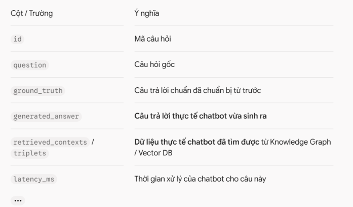
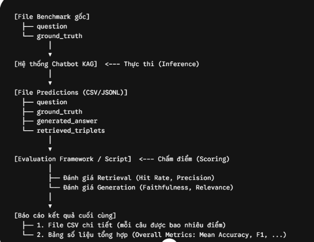
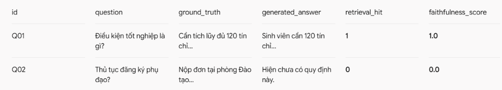

1. Sau khi chạy benchmark thực nghiệm, kết quả nhận được là gì?
Kết quả đầu ra sau khi đưa toàn bộ câu hỏi qua chatbot thường là một file JSONL hoặc CSV (thường gọi là file predictions hoặc run_logs).

File này lưu lại toàn bộ vết thực thi của hệ thống đối với từng câu hỏi trong bộ benchmark:

Tại sao JSONL thường được chuộng hơn CSV ở bước này?

Dữ liệu tri thức lấy về (retrieved_contexts hoặc đồ thị triplets) thường có cấu trúc mảng hoặc lồng nhau (nested list/dict). Lưu dạng JSONL sẽ không bị lỗi ngắt dòng hay tràn ký tự như CSV.

2. Đánh giá như thế nào? Framework nhảy vào lúc nào?Trong thực tế có 2 cách triển khai, tùy theo quy mô dự án:
Cách 1: Tách rời 2 bước (Decoupled) — Phương pháp chuẩn trong nghiên cứu và kỹ thuật phần mềmBạn không nên vừa chạy chatbot vừa chấm điểm cùng một lúc. Thay vào đó:
Bước 1 (Chạy Chatbot): Đưa file benchmark câu hỏi vào chatbot $\rightarrow$ Xuất ra file predictions.jsonl (chỉ chứa kết quả chatbot trả về).

Bước 2 (Chấm điểm): Viết một script riêng (có thể dùng DeepEval, Ragas, hoặc script Python tính toán trực tiếp) để đọc file predictions.jsonl $\rightarrow$ So sánh generated_answer với ground_truth $\rightarrow$ Xuất ra file báo cáo evaluation_results.csv.Lý do tách rời: Chạy chatbot qua API rất tốn thời gian và tiền bạc. Nếu gộp chung mà script chấm điểm bị lỗi mạng hay crash ở câu số 99, bạn sẽ phải chạy lại cả 99 câu của chatbot từ đầu. 
Tách rời giúp bạn lưu lại câu trả lời vĩnh viễn, sau đó thích dùng bao nhiêu framework hay metric chấm điểm khác nhau cũng không cần gọi lại chatbot.

Cách 2: Chạy tích hợp (All-in-one Pipeline) — Tiện cho test nhanh số lượng ítCác framework như DeepEval, Promptfoo, hay Ragas đều cho phép bạn viết một pipeline khép kín:
Framework tự động lặp qua từng câu hỏi trong file benchmark.Với mỗi câu, framework gọi hàm chatbot.ask(q).Nhận kết quả xong, framework chấm điểm ngay lập tức.Kết quả cuối cùng trả về trên terminal là một bảng tổng kết (Summary Table) kèm theo file HTML/CSV tổng hợp điểm số.

